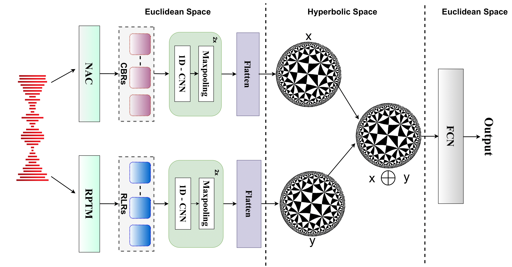

<div align="center">

# HYFuse: Hyperbolic Fusion for Speech Emotion Recognition

[](https://www.isca-archive.org/interspeech_2025/phukan25b_interspeech.html)
[](https://arxiv.org/pdf/2506.03403v1)
[](LICENSE)
[](https://www.python.org/)
[](https://www.tensorflow.org/)

</div>

---

## Overview

**HYFuse** is a novel framework for Speech Emotion Recognition (SER) that fuses heterogeneous speech representations in hyperbolic space. 

The key innovation is combining:
- **Compression-Based Representations (CBRs)** from neural audio codecs (e.g., SoundStream) - captures acoustic details like pitch and timbre
- **Representation-Learning-Based Representations (RLRs)** from pre-trained models (e.g., x-vector) - encodes semantic and prosodic information

By fusing these complementary representations in hyperbolic space, HYFuse achieves **state-of-the-art** performance on speech emotion recognition.

## Paper Details

**Title**: HYFuse: Aligning Heterogeneous Speech Pre-Trained Representations in Hyperbolic Space for Speech Emotion Recognition

**Authors**: Orchid Chetia Phukan, Girish, Mohd Mujtaba Akhtar, Swarup Ranjan Behera, Pailla Balakrishna Reddy, Arun Balaji Buduru, Rajesh Sharma

**Conference**: Interspeech 2025

## Abstract  

Compression-based representations (CBRs) from neural audio codecs such as EnCodec capture intricate acoustic features like pitch and timbre, while representation-learning-based representations (RLRs) from pre-trained models trained for speech representation learning such as WavLM encode high-level semantic and prosodic information. Previous research on Speech Emotion Recognition (SER) has explored both, however, fusion of CBRs and RLRs hasn't been explored yet. In this study, we solve this gap and investigate the fusion of RLRs and CBRs and hypothesize they will be more effective by providing complementary information. To this end, we propose, HYFuse, a novel framework that fuses the representations by transforming them to hyperbolic space. With HYFuse, through fusion of x-vector (RLR) and Soundstream (CBR), we achieve the top performance in comparison to individual representations as well as the homogeneous fusion of RLRs and CBRs and report SOTA.

---

<div align="center">
    
</div>

---

## Installation

Clone the repository:
```bash
git clone https://github.com/Helix-IIIT-Delhi/HYFuse-SER.git
cd HYFuse-SER
pip install -e .
```

---

## Key Features

✅ **Hyperbolic Fusion** - Project representations into hyperbolic space (Poincaré ball)  
✅ **Fixed or Learnable Curvature** - Support for both static and trainable curvature parameters  
✅ **Heterogeneous Fusion** - Combines complementary CBR and RLR representations  
✅ **State-of-the-Art** - Achieves best performance on SER compared to individual and homogeneous fusions  
✅ **Easy Integration** - Simple Keras/TensorFlow layers for seamless model building  
✅ **Flexible Architecture** - Works with any pre-trained speech representations  

---

## Hyperbolic Geometry Operations

HYFuse implements core hyperbolic operations:
- **Exponential Map** (Euclidean → Hyperbolic): `ExpMap0`
- **Möbius Addition**: `MobiusAdd` 
- **Logarithmic Map** (Hyperbolic → Euclidean): `LogMap0`

These enable safe arithmetic in hyperbolic space while maintaining numerical stability.

---

## Quick Start Guide

### Fixed curvature (default)

```
from hypolayers.hypo import ExpMap0           # Euclidean -> Hyperbolic
from hypolayers.mobious import MobiusAdd      # Möbius addition (alias spelling)
from hypolayers.euclidien import LogMap0      # Hyperbolic -> Euclidean (alias spelling)

exp0 = ExpMap0(curvature=1.0)
mob  = MobiusAdd(curvature=1.0)
log0 = LogMap0(curvature=1.0)

h_a = exp0(emb_a)          # [batch, d]
h_b = exp0(emb_b)
h_f = mob([h_a, h_b])      # hyperbolic fusion
z   = log0(h_f)            # back to Euclidean → Dense/Softmax...
```

## Learnable curvature

```
from hypolayers.hypo import ExpMap0
from hypolayers.mobius import MobiusAdd
from hypolayers.euclidean import LogMap0

exp0 = ExpMap0(curvature=0.8, trainable_curvature=True, curvature_param="exp")  # or "softplus"
mob  = MobiusAdd(curvature=0.8, trainable_curvature=True)
log0 = LogMap0(curvature=0.8, trainable_curvature=True)
```

## Functional wrappers

```
from hypolayers import exp_map0, mobius_add, log_map0

h_a = exp_map0(emb_a, curvature=1.0)
h_b = exp_map0(emb_b, curvature=1.0)
h_f = mobius_add(h_a, h_b, curvature=1.0)
z   = log_map0(h_f, curvature=1.0)
```

## Example: dual-modality CNN with hyperbolic fusion

```
from tensorflow.keras.layers import Input, Conv1D, MaxPooling1D, BatchNormalization, Flatten, Dense, Dropout
from tensorflow.keras.models import Model
from hypolayers.hypo import ExpMap0
from hypolayers.mobious import MobiusAdd
from hypolayers.euclidien import LogMap0

def build_hyperbolic_cnn_model(input_shape1, input_shape2, output_dim,
                               embedding_dim=128, curvature=1.0, learn_c=False):

    a_in = Input(shape=input_shape1, name="modality_a")  # e.g. (128, 1)
    b_in = Input(shape=input_shape2, name="modality_b")  # e.g. (128, 1)

    # Branch A
    xa = Conv1D(64, 3, activation='relu')(a_in)
    xa = MaxPooling1D(2)(xa); xa = BatchNormalization()(xa)
    xa = Conv1D(32, 3, activation='relu')(xa)
    xa = MaxPooling1D(2)(xa)
    xa = Flatten()(xa)
    emb_a = Dense(embedding_dim)(xa)

    # Branch B
    xb = Conv1D(64, 3, activation='relu')(b_in)
    xb = MaxPooling1D(2)(xb); xb = BatchNormalization()(xb)
    xb = Conv1D(32, 3, activation='relu')(xb)
    xb = MaxPooling1D(2)(xb)
    xb = Flatten()(xb)
    emb_b = Dense(embedding_dim)(xb)

    # Hyperbolic ops
    exp0 = ExpMap0(curvature=curvature, trainable_curvature=learn_c)
    mob  = MobiusAdd(curvature=curvature, trainable_curvature=learn_c)
    log0 = LogMap0(curvature=curvature, trainable_curvature=learn_c)

    h_a = exp0(emb_a)
    h_b = exp0(emb_b)            # same exp0 instance → shared curvature
    h_f = mob([h_a, h_b])
    z   = log0(h_f)

    z = Dense(64, activation='relu')(z)
    z = Dropout(0.5)(z)
    out = Dense(output_dim, activation='softmax')(z)

    return Model([a_in, b_in], out, name="HyperbolicFusionModel")
```


---

## Results

HYFuse achieves state-of-the-art performance on Speech Emotion Recognition:

| Configuration | Accuracy | Key Insight |
|--------------|----------|------------|
| CBR Only (SoundStream) | Baseline | Acoustic features alone |
| RLR Only (x-vector) | Baseline | Semantic features alone |
| Homogeneous CBR Fusion | Lower | CBR fusion insufficient |
| Homogeneous RLR Fusion | Lower | RLR fusion insufficient |
| **HYFuse (CBR + RLR)** | **SOTA** | **Complementary fusion in hyperbolic space** |

The hyperbolic space enables more effective fusion by capturing hierarchical and non-Euclidean relationships between representations.

---

## Methodology

### Hyperbolic Space Advantages

- **Non-Euclidean Geometry**: Better models hierarchical structures in data
- **Curvature Control**: Dynamically adjust representation space geometry
- **Numerical Stability**: Safe arithmetic operations in curved spaces
- **Information Preservation**: Lossless projection and fusion

### Architecture Components

1. **Encoder Branches**: Extract CBR and RLR from audio
2. **Exponential Maps**: Project representations to Poincaré ball
3. **Möbius Addition**: Perform fusion in hyperbolic space
4. **Logarithmic Map**: Back-project to Euclidean for classification
5. **Emotion Classifier**: Dense layers + Softmax for emotion prediction

---

## Technical Details

### Poincaré Ball Operations

The implementation uses the Poincaré ball model of hyperbolic geometry:

- **Curvature**: Positive scalar controlling space geometry
- **Exponential Map**: `exp₀(v) = tanh(√c ||v||) / (√c ||v||) × v`
- **Möbius Addition**: Non-Euclidean addition operation preserving curvature
- **Logarithmic Map**: Inverse of exponential map returning to Euclidean

### Numerical Stability

- Safe norm computations with epsilon values
- Projection to ball boundaries for numerical safety
- Trainable curvature with regularization options
- Softplus/exponential parameterization for positive curvature

---

## Citation
If you find this work useful, please consider citing us:

```bibtex

@misc{phukan2025hyfusealigningheterogeneousspeech,
      title={HYFuse: Aligning Heterogeneous Speech Pre-Trained Representations in Hyperbolic Space for Speech Emotion Recognition}, 
      author={Orchid Chetia Phukan and Girish and Mohd Mujtaba Akhtar and Swarup Ranjan Behera and Pailla Balakrishna Reddy and Arun Balaji Buduru and Rajesh Sharma},
      year={2025},
      eprint={2506.03403},
      archivePrefix={arXiv},
      primaryClass={eess.AS},
      url={https://arxiv.org/abs/2506.03403}, 
}